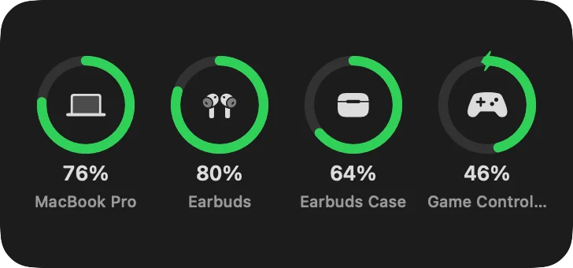
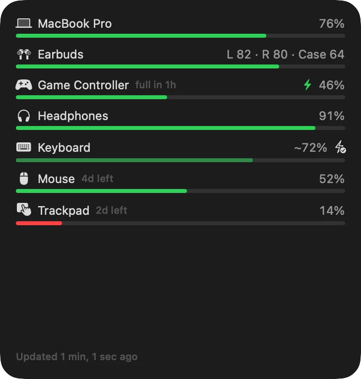
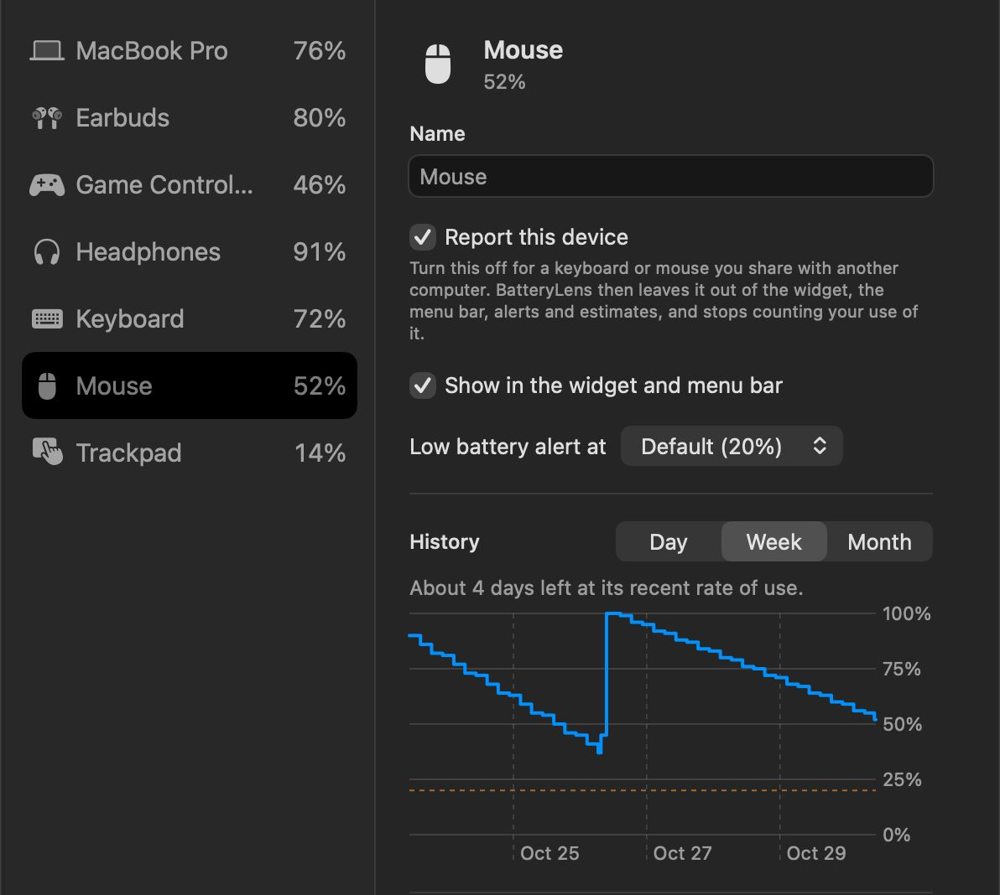

# BatteryLens

**Every battery around your Mac, in one place.** BatteryLens shows the battery level of
everything connected to your Mac: the Mac itself, AirPods and other earbuds, Bluetooth mice,
keyboards and trackpads, Logitech devices, game controllers, and even keyboards that never
report a level, which it estimates from how much you use them.

Apple's Batteries widget only knows about Apple devices and a handful of others. BatteryLens
reads every source macOS offers, so devices that otherwise show nothing get a level, a
history and a warning before they run flat.

<p align="center"> </p>

## Download

### [⬇ Download BatteryLens.dmg](https://github.com/smanke-org/BatteryLens/releases/latest/download/BatteryLens.dmg)

1. Open the downloaded **BatteryLens.dmg**.
2. Drag **BatteryLens** onto the **Applications** folder.
3. Open BatteryLens from Applications. Its icon appears in the menu bar, and a short setup
   explains the optional permissions.
4. To add the widget, right-click the desktop, choose **Edit Widgets**, and search for
   BatteryLens.

Requires macOS 26 or later. BatteryLens is free, and is currently in beta.

## Features

- **Menu bar**: the lowest battery (or one device you choose) at a glance; the menu lists
  every device with its level, charging state, and how long it should last.
- **Desktop widget** in four sizes, as **rings** like Apple's or **bars with numbers**, for
  all devices or the ones you pick, optionally including switched-off devices with their
  last-known level.
- **More devices than Apple's widget**: Logitech devices through their own protocol,
  keyboards and mice that send their battery with their input, the standard Bluetooth LE
  battery level, and AirPods levels that stay after they disconnect.
- **Estimates for devices that report nothing**: mark the keyboard as charged, and
  BatteryLens counts the minutes you use it (never what you type). It learns how long a
  charge really lasts each time the keyboard runs out. Use on all your Macs adds up through
  iCloud Drive; for a keyboard shared with another computer, turn off **Report this device**.
- **History and time left**: a chart of each battery over the last day, week or month, and
  a forecast of when it runs out or finishes charging.
- **Alerts**: a notification when a battery runs low (once per discharge, at a level you set
  per device), and optionally when one is fully charged.
- **Per-device settings**: rename, hide, set the low-battery level, or forget a device.
- The usual: System, Light or Dark appearance; show it in the menu bar, the Dock, both or
  neither; open at login; sync settings between your Macs; in-app Help (⌘?);
  `batterylens://` links for Shortcuts, scripts and ToolHUD.

## Screenshots

<table>
<tr>
<td width="50%"><br><sub><b>History and time left.</b> Each device's settings, a week of its battery, and how long it should last.</sub></td>
</tr>
</table>

## Permissions

All optional. Without any, BatteryLens still shows your Mac, AirPods and most Apple and
Bluetooth accessories.

| Permission | What it's for |
| --- | --- |
| Bluetooth | The standard battery level many Bluetooth devices report |
| Input Monitoring | Logitech devices, keyboards that send their battery with their input, and counting use for estimates. BatteryLens never reads what you type. |
| Notifications | Low-battery and fully-charged alerts, and update news |

## Updates

BatteryLens updates itself from this repository's releases. In **Settings › General**,
choose to install updates automatically (when your Mac is idle and nothing is presenting),
to be asked first, or not to check, and how often to look.

## Building

Needs Xcode 26 and [XcodeGen](https://github.com/yonaskolb/XcodeGen).

```bash
./build.sh
```

builds a Developer ID–signed, notarized copy and installs it in /Applications (the widget
only runs from a notarized app). `NOTARIZE=0` skips notarization. `swift test` runs the
tests of the BatteryLensKit package, which holds every battery source, the device merging,
the estimate and the forecasts. `./release.sh <version>` cuts a release.

## License

© 2026 Steve Manke. All rights reserved.
